<picture>
  <source media="(prefers-color-scheme: dark)" srcset="./rownd-banner.svg">
  
</picture>

# Rownd

Rownd runs savings circles in an app. A group agrees to pay in a set amount on a regular day. Each round, one person receives the pot, and it goes round until everyone has had a turn. You may know it as ajo, esusu, susu, pardner, chama or committee.

We're starting in the UK. Nigeria is coming soon, with more countries to follow. Rownd isn't live yet.

## What we're building

- **The Rownd app.** A mobile app where everyone in a circle can see the plan, whose turn it is, and who's paid.
- **The services behind it.** The systems that run accounts and circles and keep every circle's record straight.
- **The tools that run Rownd.** What our team uses to support members and look after each circle.
- **getrownd.com.** Our website.

We build for more than one country from day one. Currency and local details come from where a member lives, not from the code.

Our code is private. This page is where we say hello.

## Say hello

We're based in London. If you'd like to work with us, or just want to talk, email [support@getrownd.com](mailto:support@getrownd.com).

Website: [getrownd.com](https://getrownd.com)

---

GETROWND LIMITED, company number 17246753, registered in England and Wales.
